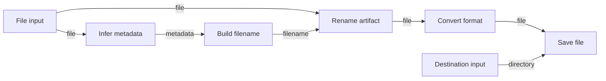

# Mushin design

Status: initial proposal.

Mushin is a Python backend for composing, validating, and executing node-based workflows. A future visual editor will let users connect nodes in a style similar to Unity Visual Scripting.

The engine is generic: it understands values, ports, dependencies, and execution. Node implementations supply domain behavior such as inspecting a file, generating a filename, or converting a format.

## Initial scope

The first version runs finite workflows locally, in one process. It supports typed inputs and outputs, graph validation, sequential execution, and execution events.

Loops, streaming, distributed workers, automatic retries, arbitrary user-supplied code, and the visual editor are outside the initial scope. Their requirements can be revisited once the basic execution model works.

## Example workflow

A workflow imports a file, infers metadata, generates a filename, renames the resulting artifact, converts its format, and saves it to a chosen destination.



The rename node waits for both the file and the generated filename. The graph does not need a connection back to the original input node.

## Core concepts

| Concept | Responsibility |
| --- | --- |
| Node definition | Declares a node type, version, configuration schema, and input/output ports. |
| Node instance | A configured use of a node definition within a workflow, with its own identifier. |
| Port | A named input or output with a declared value type. Inputs may be required or have defaults. |
| Edge | Connects an instance's output port to another instance's input port. |
| Workflow | A versioned document containing node instances, edges, and exposed inputs and outputs. |
| Node executor | Implements a node definition's behavior. |
| Execution context | Provides run identity, artifact access, logging, and cancellation. |
| Run record | Stores workflow and node status, timings, outputs, and errors for one execution. |

Use Pydantic models for serialized documents and validated values. Executors and execution contexts are runtime objects; they do not need to be Pydantic models.

A registry maps a stable node type and version to its definition and executor. Workflow documents store those identifiers and configuration, rather than Python objects or import paths. Document schema versions and node type versions evolve independently.

Editor metadata, such as node positions, is stored separately from execution semantics.

## Values and configuration

Ports initially support primitives, explicitly typed lists, named structured schemas, and artifact references. Persisted types use stable identifiers rather than Python class names.

Connected ports must have matching declared types in the first version. Conversion requires an explicit node. Validate actual values at executor input and output boundaries as well as checking connections before execution.

Configuration is saved with a node instance. Inputs arrive during execution. For example, a filename template can be configuration, while the metadata used to fill it is an input.

A workflow exposes named inputs and outputs by binding them to node ports. A bound input cannot also have an incoming edge. Required inputs must be supplied by an edge, a workflow input, or a default. Missing values are distinct from explicit null values.

## Execution rules

- A runnable workflow is a directed acyclic graph; cycles are rejected.
- A node runs once per workflow run, after all of its upstream dependencies succeed and its required inputs are available.
- Each input accepts at most one incoming edge. An output may feed multiple inputs.
- Fan-out shares values for reading; executors must not mutate shared inputs.
- The initial runner executes ready nodes sequentially, using a stable node ordering when several are ready.
- A node failure blocks its dependents. The initial runner stops scheduling further nodes and fails the run.
- Cancellation stops scheduling new nodes and requests cancellation of the active executor. Blocking operations may finish before cancellation takes effect.
- External side effects are not automatically rolled back or retried.

Before starting a run, validate and snapshot the workflow and resolve its node versions. Editing the saved workflow must not alter an active run.

The executor contract accepts validated inputs, validated configuration, and an execution context, and returns values keyed by output port name. Start with an async execution interface; blocking file operations must be delegated away from the event loop.

## Files and artifacts

Pass an `ArtifactRef` through ports instead of passing mutable filesystem paths. An artifact service resolves references to stored content and descriptive metadata.

For the first file workflow:

- Import a source file into a managed run workspace.
- Treat produced artifacts as immutable; transformations return new references.
- Rename by producing a reference with a new logical filename, potentially sharing the same underlying content.
- Convert by producing new content and a new reference.
- Save by materializing an artifact at the chosen destination.

The save node declares a collision policy, initially defaulting to an error if the destination exists. Generated filenames must not escape the selected destination directory. Operations on original source files require explicit node types.

This keeps filesystem behavior inside artifact services and file nodes rather than coupling it to the graph engine. Artifact cleanup and retention need an explicit policy before persistent runs are introduced.

## Validation and observability

Validation returns structured diagnostics containing an error code, message, and relevant node, port, or edge identifiers. Check for:

- Duplicate identifiers and missing nodes.
- Unknown node types or unsupported versions.
- Invalid configuration and port references.
- Incompatible types and conflicting input bindings.
- Missing required inputs and invalid exposed output bindings.
- Cycles.

Allow incomplete workflows to be saved as drafts. Running requires successful validation.

Node states are `pending`, `running`, `succeeded`, `failed`, `blocked`, and `cancelled`. Run states are `pending`, `running`, `succeeded`, `failed`, and `cancelled`. Dependents of a failed node become blocked; other unstarted nodes become cancelled when the run stops.

Emit events for run and node state transitions, plus executor logs. Include run and node identifiers so a future editor can display progress and highlight failures. Errors should identify the failed operation without requiring the client to parse a traceback.

## Package boundaries

```text
src/mushin/
    models/        # Workflow, node, port, edge, and run documents
    registry.py    # Node definitions and executor lookup
    validation/    # Graph and configuration diagnostics
    execution/     # Runner, context, state, and events
    artifacts/     # Artifact references and local storage
    nodes/         # Built-in node definitions and executors
    persistence/   # Workflow and run storage, added later
    api/           # HTTP and event transport, added later
```

The core engine must be callable directly from Python. An eventual API exposes node discovery, workflow save/load and validation, run submission and cancellation, run events, and artifact access.

## Implementation milestones

1. **Graph contracts and registry:** model definitions and instances, ports, edges, and workflow input/output bindings. Verify JSON round-tripping with an example workflow.
2. **Validation:** implement structured diagnostics and cover invalid connections, missing inputs, configuration errors, and cycles.
3. **Execution:** implement a sequential runner with run records and events. Verify dependency ordering, fan-out, joins, failure propagation, and cancellation using small pure-data nodes.
4. **File workflow:** add local artifact storage and the example node types. Verify a fixture reaches its destination with the expected name and format, including collision and failure cases.
5. **Persistence and API:** store workflow drafts and run snapshots, then expose the engine to a client.
6. **Reliability:** add timeouts, bounded concurrency, artifact retention, and explicit retry policies where node side effects permit them.

The first implementation target is milestones 1–3. This establishes the generic engine before filesystem operations and frontend integration add complexity.
